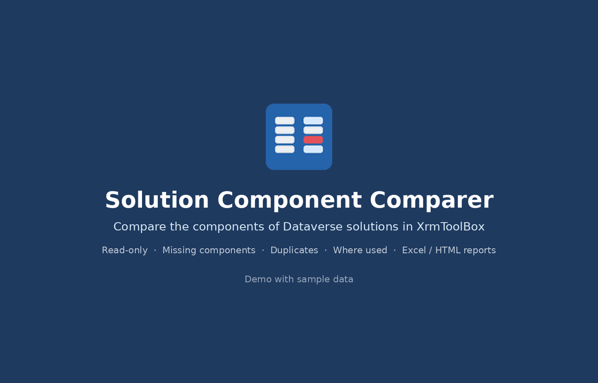

# Solution Component Comparer for XrmToolBox

An [XrmToolBox](https://www.xrmtoolbox.com) tool that compares the components of Dataverse / Dynamics 365 solutions.

Pick a set of **source** solutions and a set of **target** solutions. The tool lists every component they contain and shows, for each one, whether the targets cover it. It also finds components that sit in more than one solution and shows every solution a component belongs to.

The tool is **read-only**. It only reads solutions, solution components and metadata. It never creates, updates or deletes anything, so it is safe to run against any environment, including production.



*Demo with sample data.*

## Use cases

- Check that the components of some solutions are fully contained in other solutions before removing them.
- Verify the result after splitting, merging or restructuring solutions.
- Find components packaged in more than one solution.
- Find out which solutions contain a given component.
- Export a component inventory of one or more solutions.

## Features

- **Source / target comparison.** All components of the selected solutions in one colour-coded list, matched on `(componenttype, objectid)` from the `solutioncomponent` table.
- **"Also in other solutions" check.** For every component missing in the targets, the tool lists the other solutions in the environment that still contain it (Default and Active excluded).
- **Root component behavior awareness.** Detects when a table is included with all subcomponents on one side and with fewer on the other, and treats columns, forms, views and relationships as covered when their table is included with all subcomponents.
- **Duplicates view.** Components contained in two or more selected solutions, with an option to show only overlaps between target solutions.
- **Where used.** Every solution in the environment that contains the selected component, with managed state and include behavior.
- **Readable names.** Tables, columns, relationships, keys, global choices, forms, views, web resources, plugin steps, environment variables and other components are shown by name rather than by GUID.
- **Filtering.** By status, by component type and by free text (name, table, solution, id).
- **Export.** Excel workbook (Summary, Comparison, Duplicates, Solutions sheets with autofilter) or a self-contained HTML report with status filters, search and sortable columns. Export all rows or only the rows visible in the grids.
- **Remembered selection.** Source and target picks are saved per connection.

### Comparison statuses

| Colour | Status | Meaning |
|---|---|---|
| Red | Missing in target | In a source solution, in none of the target solutions. |
| Amber | Target has less | In both, but the targets include less of it, e.g. a table with all subcomponents in a source and without subcomponents in a target. |
| Blue | Only in target | In a target solution, in none of the source solutions. |
| Green | Covered by table | Not listed by itself on one side, but its table is included there with all subcomponents. |
| White | In both | In at least one source and at least one target solution. |
| White | Listed | No target solution selected: plain component list of the sources. |

## Requirements

- XrmToolBox 1.2025.10 or later (.NET Framework 4.8)
- To build: Windows, the .NET SDK or Visual Studio 2022+, internet access for NuGet restore

## Build

From the repository folder:

```
.\build.cmd
```

The Release build is written to `dist\SolutionComponentComparer.dll`. The equivalent command is:

```
dotnet build src\SolutionComponentComparer\SolutionComponentComparer.csproj -c Release
```

XrmToolBox references come from the [XrmToolBoxPackage](https://www.nuget.org/packages/XrmToolBoxPackage) NuGet package.

## Install

1. Close XrmToolBox.
2. Copy `SolutionComponentComparer.dll` into the XrmToolBox Plugins folder (`%APPDATA%\MscrmTools\XrmToolBox\Plugins` for a standard installation).
3. Start XrmToolBox, open the **Tools** tab and search for **Solution Component Comparer**.

To uninstall, close XrmToolBox and delete the DLL from the Plugins folder.

## Usage

The full walkthrough with screenshots is in the [user guide](docs/user-guide.md). In short:

1. Connect to an environment and open the tool. The solution list loads automatically.
2. Select the solutions to check and click **Set as Source**. Select the solutions that should contain their components and click **Set as Target**. Multi-select (Ctrl/Shift) and the filter box help with long lists.
3. Click **Compare**.
4. Click **problems only** to keep the red and amber rows. For red rows, check the **Also in other solutions** column.
5. Double-click a row (or click **Where used?**) to list every solution that contains that component.
6. Use **Export report** to save the result as Excel or HTML.

Selecting only source solutions and no target gives a plain component list of those solutions.

## Documentation

- [User guide](docs/user-guide.md): picking solutions, reading the results, filters, Where used, duplicates, export, troubleshooting.
- [Changelog](CHANGELOG.md)

## Project structure

```
src/SolutionComponentComparer/
  SolutionComponentComparerPlugin.cs    XrmToolBox entry point (MEF export, metadata, icons)
  SolutionComponentComparerControl.cs   User interface
  Core/                                 Comparison engine and report writers (no Dataverse dependency)
  Data/                                 Read-only Dataverse queries and component name resolution
  UI/                                   Grid row models, settings, sortable binding list
tests/                                  Console test runner for the engine, reports and repository paging
docs/                                   User guide and images
```

Run the tests:

```
dotnet run --project tests\SolutionComponentComparer.Tests.csproj
```

Exit code 0 means all tests passed.

## Roadmap

- List the individual subcomponents behind "Target has less" rows.
- Compare solutions across two environments.
- Show the XML difference of a component between solutions.
- Publish to the XrmToolBox Tool Library.
