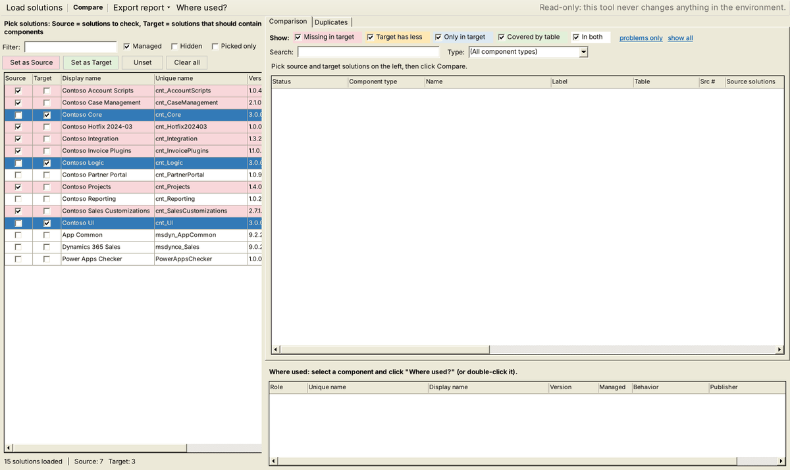
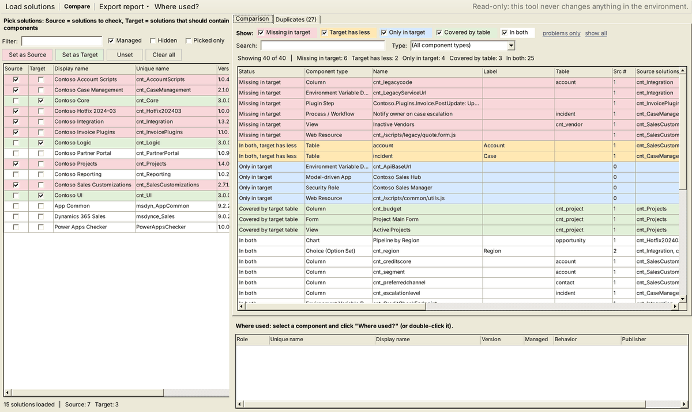
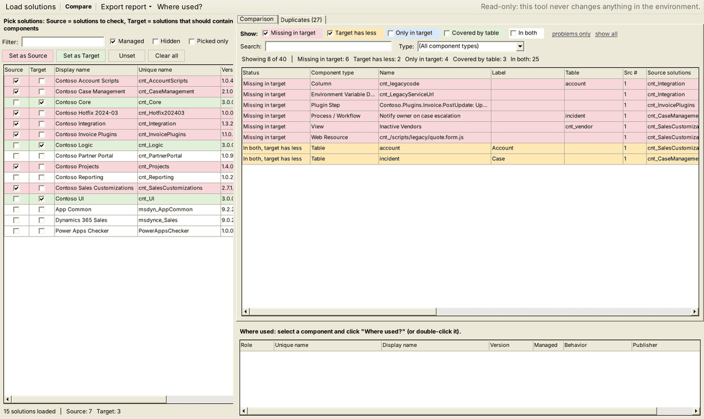
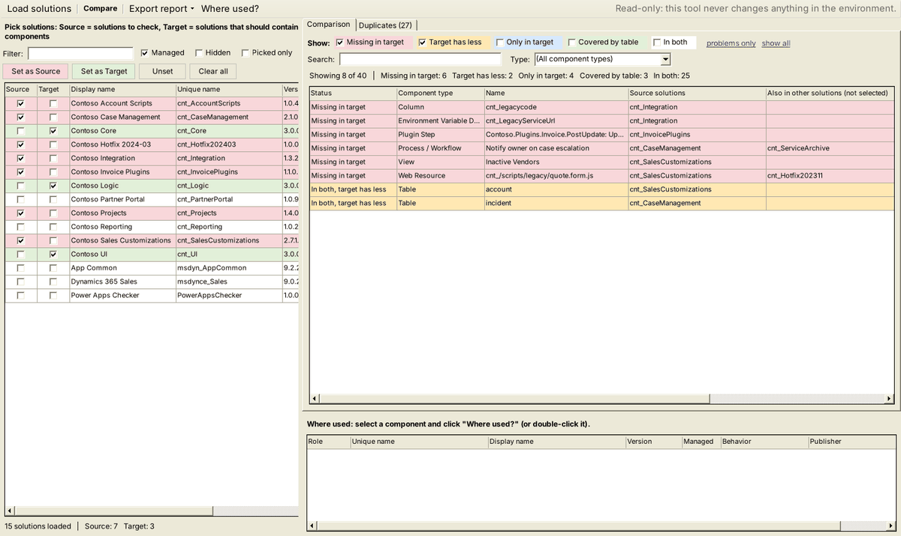
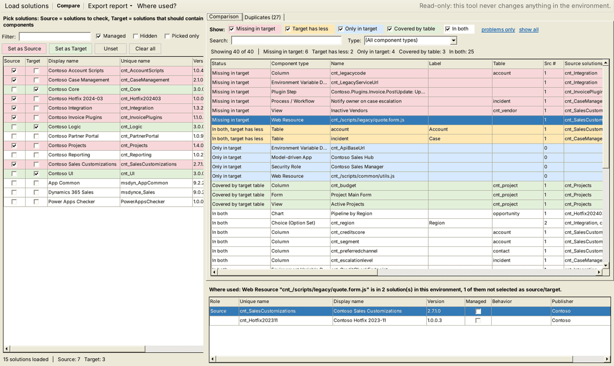
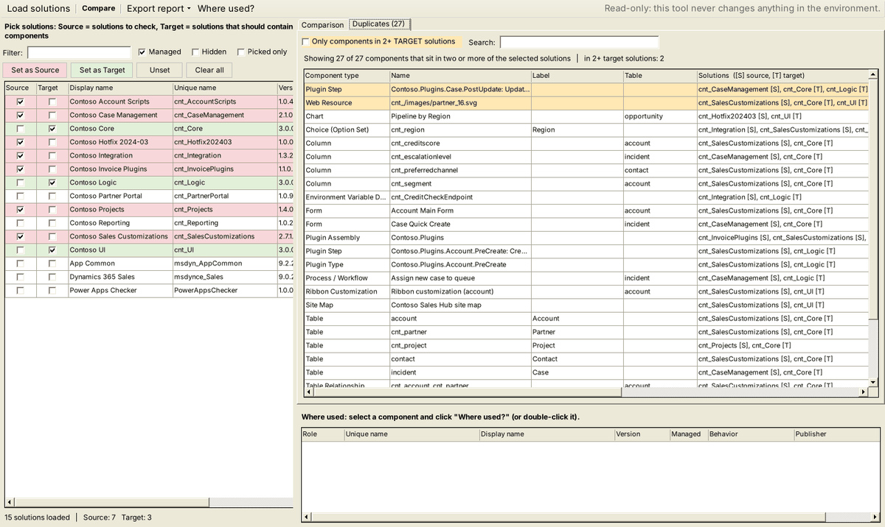
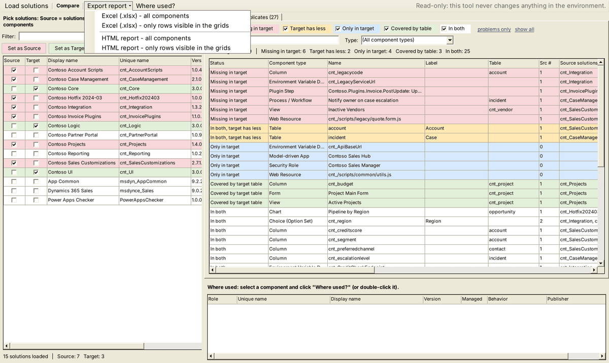

# User guide

This guide explains how to use Solution Component Comparer in XrmToolBox. For a quick overview, see the [README](../README.md).

- [1. Install](#1-install)
- [2. Open the tool](#2-open-the-tool)
- [3. Pick source and target solutions](#3-pick-source-and-target-solutions)
- [4. Compare](#4-compare)
- [5. Read the results](#5-read-the-results)
- [6. Filter the results](#6-filter-the-results)
- [7. Check where a component is used](#7-check-where-a-component-is-used)
- [8. Find duplicates](#8-find-duplicates)
- [9. Export a report](#9-export-a-report)
- [10. Before removing solutions](#10-before-removing-solutions)
- [11. Troubleshooting](#11-troubleshooting)

The screenshots use sample data.

## 1. Install

1. Close XrmToolBox.
2. Copy `SolutionComponentComparer.dll` into the XrmToolBox Plugins folder. For a standard installation it is `%APPDATA%\MscrmTools\XrmToolBox\Plugins` (paste the path into Windows Explorer or the Run dialog, Win + R).
3. Start XrmToolBox.

To build the DLL from source, see [Build](../README.md#build).

## 2. Open the tool

1. Connect to an environment.
2. Open the **Tools** tab, search for **Solution Component Comparer** and open it.

The solutions of the environment load automatically on the left. **Load solutions** on the toolbar reloads them.

The tool only reads data. A note on the right side of the toolbar confirms this.

## 3. Pick source and target solutions

- **Source**: the solutions you want to check.
- **Target**: the solutions that should contain the components of the sources.

To pick solutions:

1. Use **Filter** to narrow the list by display name, unique name or publisher.
2. Select rows with Ctrl+click or Shift+click.
3. Click **Set as Source** or **Set as Target**. You can also tick the **Source** and **Target** checkboxes in the grid.

Sources are highlighted in red, targets in green. A solution is either a source or a target, never both. **Unset** clears the selected rows, **Clear all** clears every pick.

Other options:

| Option | Effect |
|---|---|
| Managed | Shows managed solutions. |
| Hidden | Shows hidden system solutions. |
| Picked only | Shows only the solutions marked as source or target. |

The status line at the bottom shows how many sources and targets are picked. Picks are saved per connection and restored the next time you open the tool.

## 4. Compare

Click **Compare**.

The tool reads the solution components of all picked solutions, resolves their names and builds the comparison. The first comparison on a connection also loads table metadata (tables, columns, relationships, keys), which can take up to a minute in large environments. Later comparisons reuse it.

If you pick only sources and no target, the result is a plain component list of the sources (status **Listed**).

## 5. Read the results

Each row is one component. Components are identified by component type and object id, the same identity Dataverse uses in the `solutioncomponent` table, so a component that appears in several solutions is shown once.

### Statuses

| Colour | Status | Meaning | What to do |
|---|---|---|---|
| Red | Missing in target | In a source solution, in none of the targets. | Add it to a target, or confirm it is no longer needed. |
| Amber | Target has less | In both, but the targets include less of it. Typical case: a table included with all subcomponents in a source and without subcomponents (or as shell only) in a target. | Compare the table's columns, forms and views between the solutions. |
| Blue | Only in target | In a target, in none of the sources. | Usually fine. New or moved components show up here. |
| Green | Covered by table | Not listed by itself on one side, but its table is included there with all subcomponents. | Nothing. The component travels with its table. |
| White | In both | In at least one source and at least one target. | Nothing. |
| White | Listed | No target picked. | Nothing. |

### Columns

| Column | Content |
|---|---|
| Status | Status of the component. |
| Component type | Table, Column, Form, View, Web Resource, Plugin Step, Environment Variable Definition, and so on. |
| Name | Logical name, schema name or record name of the component. |
| Label | Display name, where the component has one. |
| Table | The table the component belongs to (columns, forms, views, relationships, keys, charts). |
| Src # / Source solutions | How many and which picked sources contain the component. |
| Tgt # / Target solutions | How many and which picked targets contain the component. |
| Source behavior / Target behavior | For tables: All subcomponents, No subcomponents or Shell only. |
| Also in other solutions (not selected) | For red rows only: other solutions in the environment that also contain the component. Default and Active are not counted. |
| Object id / Type code | Technical identity of the component. |

Click a column header to sort. Right-click a row to copy names, object ids or whole rows.

## 6. Filter the results

- **Show** checkboxes switch statuses on and off.
- **problems only** keeps Missing in target and Target has less.
- **show all** turns every status back on.
- **Search** matches name, label, table, solution names and object id.
- **Type** limits the list to one component type.

The summary line shows how many rows are visible and the totals per status.

### Also in other solutions

For components missing in the targets, this column answers the question "does anything else still hold this component?". An empty cell means none of the other solutions in the environment contain it.

## 7. Check where a component is used

Double-click a row, or select it and click **Where used?**. The bottom panel lists every solution in the environment that contains the component, with:

- **Role**: Source or Target if the solution is picked, empty otherwise.
- **Managed**, **Version**, **Publisher**.
- **Behavior**: include behavior for tables.

Where used works from the Comparison and the Duplicates tabs.

## 8. Find duplicates

The **Duplicates** tab lists components that sit in two or more of the picked solutions. The **Solutions** column lists them with `[S]` for sources and `[T]` for targets.

Tick **Only components in 2+ TARGET solutions** to see components shared between target solutions. These rows are highlighted in amber.

## 9. Export a report

**Export report** offers four options:

| Option | Content |
|---|---|
| Excel (.xlsx) - all components | Every row of the comparison and every duplicate. |
| Excel (.xlsx) - only rows visible in the grids | Only what the current filters show. |
| HTML report - all components | Same as Excel, as a single HTML file. |
| HTML report - only rows visible in the grids | Same as Excel, filtered. |

The Excel workbook has four sheets: **Summary** (environment, solutions, counts per status, missing components by type), **Comparison**, **Duplicates** and **Solutions**. Rows are coloured by status and the sheets have autofilter enabled.

The HTML report is a single self-contained file. It has status checkboxes, a search box and sortable columns, and it opens in any browser.

## 10. Before removing solutions

The tool does not remove anything. It helps you decide whether removing solutions is safe. Keep in mind how Dataverse handles solution removal:

- **Unmanaged solution**: deleting it removes only the solution container. Its components stay in the environment, but they no longer travel with that solution.
- **Managed solution**: uninstalling it removes its components, except those that another managed solution also contains.

A suggested check:

1. Pick the solutions you plan to remove as sources and the solutions that should remain as targets.
2. Compare and click **problems only**.
3. For each red row, decide whether the component must be added to a target. Check **Also in other solutions** and **Where used?** for context.
4. For each amber row, compare the subcomponents of the table between the solutions.
5. Export the report and keep it with your release notes.

## 11. Troubleshooting

| Problem | Solution |
|---|---|
| The tool is not in the Tools list | Check that the DLL is directly in the Plugins folder, not in a subfolder, and restart XrmToolBox. If Windows blocked the downloaded file, open its Properties and tick **Unblock**. |
| Names show as "(unresolved)" | The component record could not be read (for example missing privileges or a deleted record). The object id and type code are still shown. Details are in the XrmToolBox log. |
| The first comparison is slow | Table metadata is loaded once per connection. Later comparisons are faster. |
| An error message appears | Open the XrmToolBox log (`%APPDATA%\MscrmTools\XrmToolBox\Logs`) for the full error and report it as an issue. |
